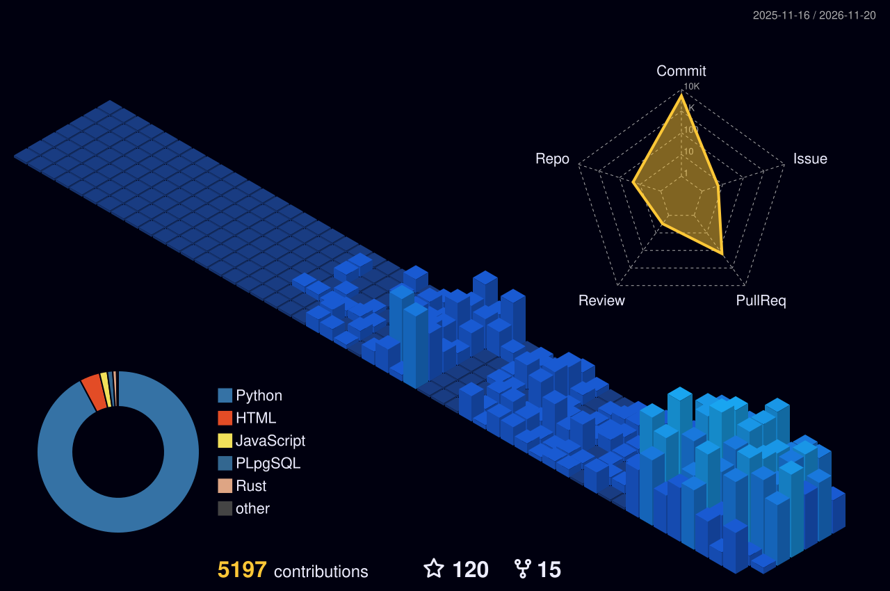

  

  

## About

- Building **Vibelution**, a local-first AI agent workbench: research teams that plan, build and review together, plus a finance agent and virtual human companions — in one Electron desktop app.
- Working across the stack: Python services and agent orchestration on the backend, TypeScript + React + Electron on the frontend.
- Most of my projects run locally or talk only to my own devices — local-first is the common thread.
- Also building for HarmonyOS: [harmony-codex](https://github.com/CCDawn/harmony-codex) and [pc-touchpad](https://github.com/CCDawn/pc-touchpad) connect phones and PCs directly over LAN.

## 🚀 Projects

- **[Vibelution](https://github.com/CCDawn/Vibelution)** — Local-first AI agent workbench (Electron + Python): research teams that plan, build and review together, a finance agent, and virtual human companions. My flagship project.
- **[Codex-Dynamic-Skin](https://github.com/CCDawn/Codex-Dynamic-Skin)** — Themes, static & live wallpapers for the Codex desktop app, with an exclusive default-wallpaper mode.
- **[briefbound-skills](https://github.com/CCDawn/briefbound-skills)** — Agent skill pack for coding, research and review workflows, with a Briefbound Router entry point.
- **[vera20k-superai](https://github.com/CCDawn/vera20k-superai)** — Super AI plugin for VERA20k: a stronger, human-style computer opponent, written in Rust.
- **[harmony-codex](https://github.com/CCDawn/harmony-codex)** — Continue desktop Codex tasks from HarmonyOS phones, foldables and tablets: sessions, messages, approvals and quota, over LAN or an optional relay.
- **[pc-touchpad](https://github.com/CCDawn/pc-touchpad)** — Turn a HarmonyOS phone into an Apple-style trackpad for Windows PCs: LAN WSS auth, semantic gesture protocol, whitelisted SendInput.
- More: **[An-Intelligent-Investment-Agent](https://github.com/CCDawn/An-Intelligent-Investment-Agent)** — financial RAG question-answering over company annual reports (hybrid retrieval + query routing).

## 🛠 Skills

## 📊 GitHub Stats

<picture>
  <source media="(prefers-color-scheme: dark)" srcset="https://github-stats-extended.vercel.app/api?username=CCDawn&theme=dark_github&show_icons=true&hide_border=true" />
  
</picture>

<picture>
  <source media="(prefers-color-scheme: dark)" srcset="https://github-stats-extended.vercel.app/api/top-langs/?username=CCDawn&layout=compact&theme=dark_github&hide_border=true" />
  
</picture>

## 📈 Growth

<a href="https://www.star-history.com/?repos=CCDawn%2FVibelution&type=Date">
  <picture>
    <source media="(prefers-color-scheme: dark)" srcset="https://api.star-history.com/svg?repos=CCDawn/Vibelution&type=Date&theme=dark" />
    
  </picture>
</a>

## ⏰ Coding Habits

*Rendered daily by [lowlighter/metrics](https://github.com/lowlighter/metrics) via GitHub Actions.*

## 🏙 3D Contributions

*Generated daily by [yoshi389111/github-profile-3d-contrib](https://github.com/yoshi389111/github-profile-3d-contrib) via GitHub Actions.*

---

Want to get in touch? Open an issue on [Vibelution](https://github.com/CCDawn/Vibelution/issues).
